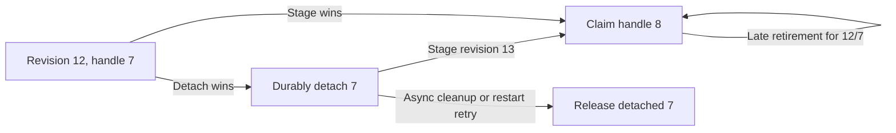

# Checked Logkeeper reclamation and read routing

Implement revision-fenced retirement and bounded local reclamation alongside the existing keeper-hosted consensus design. Put preferred read routing after the storage and ownership fixes. The committed stream journal remains the authority for membership, committed bytes and caller-authorized trim. The physical ledger and routing cache have separate owners.

## 1. Serialize retirement with learner installation

Use one local ownership record per stream and keeper incarnation. It carries a durable revision high-water mark, a never-reused install generation, the active or staged handle, and pending detached handles. Retirement needs checked committed exclusion for that stream and revision, including exclusion from both sides of a joint roster, and a matching local generation. Validate against the latest trusted evidence under the same ownership boundary that admits staging. A bare revision, untrusted discovery answer or unknown authority leaves the copy in place.

Perform a durable compare-and-detach. Report completion when that transition is durable. Cleanup takes the detached handle, never a path looked up by stream ID. Stage claims a fresh handle under the same gate and records the target membership revision before copying begins. Verify the staged move receipt, source revision and destination incarnation; use compare-and-install on the same staged handle and the existing checked installation rule for the exact learner cut. Preserve durable hard term and vote separately from reclaimed payload. An incarnation that lost that trusted evidence stays disabled and needs a fresh enrolled identity.

Lean proves current handles and detached ownership stay disjoint, generation high-water never regresses and the retirement overlay preserves hard state. Checked detach projects to a core disconnect with the identical committed log. The staging bridge uses the existing published move receipt. The executable revision 12/13 cuts include both orders, a delayed and duplicate retirement, and restart between durable detach and unlink. Exercise the same cuts in Rust, including an old install callback after the handle changed, crash after durable vote, and inability to obtain exclusion evidence. [Retirement.lean](Logkeeper/LeaderJournal/Retirement.lean)

## 2. Bound the entire durable route through a full suffix

Use **shared immutable payload extents and one durably published recovery root**. Ordinary local snapshot creation references retained payload extents. It writes bounded metadata and any bounded immutable extent boundary fragments. Use the existing owner for selection, `Selected` plus the durability barrier for `Record::Snapshot`. Persist and validate new referenced files and directory entries before publishing the selected root, then make that selection durable before exposing it, advancing the Raft purge floor or retiring the previous recovery files. The root describes the exact applied cut and binds its included index, term, membership, reducer fields, retained extents and checksums. Keep the accepted suffix and trusted term/vote across publication. Restart uses the durable selection, verifies its dependencies and reconstructs cleanup and charges conservatively.

Make the metadata bound concrete. A root over bounded-size immutable index pages with a bounded depth is one design. Cap changed pages, extent operations, worst-case extent copies, maximum file sizes, directory and allocator overhead, and concurrently produced bytes per batch. Advance work with a durable cursor where necessary. Full index rewrites, full pack rewrites and an unbounded directory walk on the gate-clearing path have the same problem as full payload rewrites. Segment the WAL so a bounded purge can retire closed segments and rewrite at most a bounded boundary, without copying the growing concurrent suffix. Reserve a safe maximum for the relevant geometry, including recovery and cleanup metadata. Keep the units in allocated blocks or conservative byte upper bounds, including reservations, old roots and detached files.

Split the volume budget into ordinary, bounded durable protocol control, maintenance control/metadata records, maintenance scratch, transfer/installation, and bounded external allocations. Keep maintenance scratch and durable control unavailable to transfer and ordinary admission even when maintenance is idle. Reserve a local maintenance queue slot and the durable worker service needed to write the selected root and purge record; the app and bulk queues must never own the last such slot. A scheduler may serialize bounded maintenance batches across groups. Existing peer control keeps its own reservation for votes, fresh-head confirmation and required protocol writes. Check every physical bottleneck in the completion path. Rotate or checkpoint obsolete maintenance-control records with a measured bounded peak before crediting their blocks. A full maintenance reserve or physical I/O refusal yields local resource exhaustion or quarantine under the media rules. The deterministic reducer continues to enforce the separate logical per-stream retained-byte quota.

Reserve ordinary bytes and pending suffix slots atomically before admitting work. Convert a ticket to actually allocated bytes and an occupied suffix slot at durable append. A cancel consumes the ticket exactly once. Reconcile a partially written or uncertain append before releasing its suffix slot, and keep its allocated bytes charged until verified disposal. Account shared volume allocations once across all streams. Use backpressure for transfer. Incoming install and outbound staging may use authenticated, admitted streaming with bounded chunks, concurrent sessions and total per-volume destination or spill allocations. Local publish must not create a full outbound staging file in maintenance scratch. A transfer pins one selected root, and the OpenRaft 0.9.25 default chunk sender seeks to the end and to each retry offset. Provide stable seekable bytes over that pinned root or explicitly version the transport with equivalent retry semantics. Charge allocations on the destination even with bounded buffers. [OpenRaft 0.9.25 `src/network/snapshot_transport.rs:138–185`](https://docs.rs/crate/openraft/0.9.25/source/src/network/snapshot_transport.rs)

Choose the independent applied snapshot and Raft purge path for the current `MAX_LOG_SUFFIX` gate. Appending `Trim` still uses the ordinary gate and still needs caller authorization and consensus. Local purge consumes its reserved lane and only advances through the exact coverage of the selected durable applied image. This can reopen suffix slots while physical bytes remain charged. Application retention changes only via committed trim; physical credits return only when the allocator has the space back. Retire only objects that the new root, suffix, other live roots, installations and exact reader/transfer handles cannot reference. Use bounded or cancellable pins with explicit ownership through retries. Unlinked open Unix files can remain charged until the last handle closes.

The model establishes conservation of reservations, suffix admission with pending slots, physically separate maintenance headroom, selected-image coverage and history preservation, and finite reclaim-then-admit with sufficient net reclaimable bytes. `full_writes_and_transfers_leave_maintenance_available` exercises ordinary bytes, suffix and transfer saturation at once. `purge_reopens_suffix_while_pinned` separates suffix admission from physical return. `checked_publish_and_purge` links the durable root to the exact existing media model. `reclaim_then_admit` uses a fitting batch, a covering cut at the checked adapter, independent maintenance records, enough byte and suffix gain, and unpinned reclaim targets by unlink. Scheduling, successful sync and allocation, correct measured bounds, authenticated eligible peers when protocol recovery is required, and actual reclamation of allocated blocks are premises. Peer control feasibility and election recovery are checked separately in `PeerBudget.saturated_budget_allows_recovery_schedule`. With no covered cut, no net reclaimable bytes, exhausted reserve, indefinite pins or failed I/O, there is no unconditional progress bound. [Headroom.lean](Logkeeper/LeaderJournal/Headroom.lean) [PeerBudget.lean](Logkeeper/LeaderJournal/PeerBudget.lean)

Exercise these cuts in Rust:

- Reserve concurrently at ordinary and suffix limits, race completion with cancellation, preserve partial allocations and prove duplicate release cannot return credits twice. Fill bulk admission with maintenance idle, then trigger a full-suffix snapshot and purge through the reserved worker, including the case where `Group::write(Trim)` would reject.
- Crash or inject I/O failure after new files sync and before selected-root publication, during publication and after publication before purge, after purge before unlink, and after unlink before releasing accounting. Restart must find a readable exact cut or fail closed, and an unresolved temporary or unlinked-open allocation remains charged. Reject or defer work when real headroom is missing.
- Pause an old read or outbound transfer across selection, purge and reclaim. Verify stable offsets/bytes under transfer retry, immediate suffix availability where covered, exact pin ownership, and delayed block credits. Try an incoming install at the transfer limit and verify the maintenance reserve stays available.
- Preserve any supported existing format. The inspected consensus snapshot reader checks `LKRIMG03`. Keep reading the existing selected image and preserve wire compatibility if continuing the current sender. Version new on-disk manifest roots explicitly. Keep a supported old image as an immutable recovery basis while upgrading in bounded steps, or record a supported migration procedure with its own required disk budget. Switch through the same durable selection point. Exercise round-trip and crash/reopen of an old-format image with term/vote, applied index, trim floor, head and committed membership intact. Confirm the supported compatibility matrix in the Rust handoff.

## 3. Route ordinary pages through the last committed roster

Cache a verified committed roster by authenticated stream/genesis and monotone revision. Try one preferred keeper, conditionally start one alternate after the hedge delay, then use a bounded fallback set and a bounded refresh budget under the call deadline. Deduplicate routes and cancel redundant calls. Old and staged contacts supply discovery only. The same authenticated healthy applied-page response can be useful after membership changes, including a move to a disjoint roster. It must match stream/genesis, request bounds and the requested minimum head. A page describes its own cut and floor. Fresh head and any stronger freshness requirement use the existing quorum-confirmed path. A cache miss, stale contact or unreachable roster does not prove absence. Only a trusted catalog binding lookup can establish never-created absence.

Lean checks exact committed bytes across a later trace, identity and minimum-head rejection, bounded fallback, an obsolete roster reaching discovery and a slow primary triggering one hedge. The delayed-response result uses the ghost committed history, which keeps byte identity across trim. It preserves the applied-page contract, including the requested floor/head bounds at the served cut. Keep the existing trim/deletion semantics and page bounds. Exercise obsolete contacts after a disjoint move, a slow primary, an old response below the caller's newer head, a different genesis, and a partition with no usable discovery response. [ReadRouting.lean](Logkeeper/LeaderJournal/ReadRouting.lean)

## Source evidence and limits

- Neon explicit exclusion checks generation under the ownership lock before cancellation and removal. Its controller retry has a generation-check TODO. BookKeeper closed-ledger GC rereads metadata under its replication lock. These supply the recheck/ownership pattern. Logkeeper also requires exact local generation and persistent hard-state evidence. [Neon explicit exclusion](https://github.com/neondatabase/neon/blob/fa504217c61bbcaf5c512d75830564541f917f8f/safekeeper/src/timelines_global_map.rs#L565-L599) [Neon controller retry](https://github.com/neondatabase/neon/blob/fa504217c61bbcaf5c512d75830564541f917f8f/storage_controller/src/service/safekeeper_reconciler.rs#L391-L409) [BookKeeper closed-ledger GC](https://github.com/apache/bookkeeper/blob/7b66b5d7631cecc9198c5d555d8b2d28d3b6525d/bookkeeper-server/src/main/java/org/apache/bookkeeper/bookie/ScanAndCompareGarbageCollector.java#L249-L359)
- BookKeeper's disk thresholds govern local write admission. Its transactional compactor durably publishes replacement data and location updates before source removal. Neon computes a removal horizon and holds retention during timeline pulls. These support separate capacity and reclaim-safety conditions. Neither source provides Logkeeper's snapshot peak or suffix-gate proof. [BookKeeper disk monitor](https://github.com/apache/bookkeeper/blob/7b66b5d7631cecc9198c5d555d8b2d28d3b6525d/bookkeeper-server/src/main/java/org/apache/bookkeeper/bookie/LedgerDirsMonitor.java#L123-L151) [BookKeeper replacement flush](https://github.com/apache/bookkeeper/blob/7b66b5d7631cecc9198c5d555d8b2d28d3b6525d/bookkeeper-server/src/main/java/org/apache/bookkeeper/bookie/TransactionalEntryLogCompactor.java#L244-L267) [BookKeeper index and removal](https://github.com/apache/bookkeeper/blob/7b66b5d7631cecc9198c5d555d8b2d28d3b6525d/bookkeeper-server/src/main/java/org/apache/bookkeeper/bookie/TransactionalEntryLogCompactor.java#L304-L324) [Neon removal horizon](https://github.com/neondatabase/neon/blob/fa504217c61bbcaf5c512d75830564541f917f8f/safekeeper/src/remove_wal.rs#L17-L32) [Neon pull hold](https://github.com/neondatabase/neon/blob/fa504217c61bbcaf5c512d75830564541f917f8f/safekeeper/src/pull_timeline.rs#L349-L395)
- Neon filters WAL candidates using validated commit applicability. BookKeeper can try another ensemble member speculatively. Logkeeper borrows preference and bounded speculation; the validity of a page follows its authenticated applied cut. [Neon candidate filter](https://github.com/neondatabase/neon/blob/fa504217c61bbcaf5c512d75830564541f917f8f/pageserver/src/tenant/timeline/walreceiver/connection_manager.rs#L977-L1009) [BookKeeper speculative read](https://github.com/apache/bookkeeper/blob/7b66b5d7631cecc9198c5d555d8b2d28d3b6525d/bookkeeper-server/src/main/java/org/apache/bookkeeper/client/PendingReadOp.java#L328-L375)
- The local Rust source was inspected in the implementation worktree at base `f819553ae6a8c798995b98af45c5f9d0b80b5a62` with in-progress consensus files. Exact anchors as lines move are `src/stream/consensus/keeper.rs` `Group::write`, `MAX_LOG_SUFFIX`, `Command::Trim`; `storage/mod.rs` `RaftLogStorage::purge` and `wait_for_snapshot`; `storage/snapshot.rs` `build_snapshot`, `Inner::select` and `Record::Snapshot`, `write_image` and `LKRIMG03`; `storage/wal/compaction.rs` compaction capture, tail copy and replacement; `state.rs` append quota; `client.rs` `read` and `head`; and `storage/wal.rs` `CatalogEntry::contacts`, `Record::Claim` and `Record::Stage` for discovery hints. Existing `src/stream/keeper/checkpoint.rs:189–213,263–270,345–389` is local prior art for sharing immutable extents with remaining full metadata and pack rewrites. The handoff baseline has full retained payload copies and a second WAL during compaction, so a bounded WAL rewrite alone cannot provide the end-to-end bound.

The Lean transition model checks the stated invariants and finite schedules. Rust must establish actual metadata and I/O bounds, filesystem durability and ownership, queue and storage enforcement, compatibility, and the correspondence between checked events and runtime behavior.

## Verification

Focused build passed for `Retirement`, `Headroom` and `ReadRouting` with 16 jobs. The combined `lake build Logkeeper` passed with 58 jobs on `leanprover/lean4:v4.35.0`. The axiom audit covered all 41 theorem declarations in the three follow-up modules and found only `propext`, `Classical.choice` and `Quot.sound`. These are Lean checks; the Rust implementation and its fault-cut verification remain the receiving agent's work.
