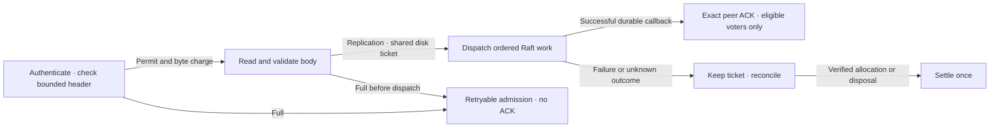

# LK-REPLICATION-ADMISSION

Apply this after the checked reclamation follow-up. Follower payload must pass receiving-side admission for transport, allocated disk bytes, and bounded durable-worker service. The same rules cover live follower replication and catch-up. Leave the client contract and committed-journal authority in place. This contract extends [the reclamation handoff](reclamation-handoff.md).

## Receive and classify

- Classify the whole ordered operation by the actual decoded entries. A vote, an empty AppendEntries including a fresh-head probe, and bounded protocol-only metadata are eligible for control. One user record in a batch makes the whole batch replication data. Never split a mixed request in a way that skips or reorders Raft entries. Check protocol terms, stream/genesis and membership as usual. The same content rule applies at the storage boundary, independent of who owns the local vote or leads the stream.
- Authenticate the peer and validate the lane and declared length from a bounded header before reserving or allocating the body. Give control its own small frame and aggregate work limit. Use separate receiver-wide and per-authenticated-sender caps for replication bytes, shared across that sender's connections and streams. Count concurrent buffers and the bounded decoder/worker representation, including copies during handoff. Also limit frame sizes, queue count and decode work. Validate the claimed class against decoded contents before dispatch. A control-lane frame carrying user records gets no control work. Keep idle authenticated connections and the shared handshake/listener path from consuming all useful control ingress. Bound bulk snapshot transfer separately.
- Give each receiving keeper an admission decision for the full destination allocation before dispatch into Raft storage. Charge the existing disk owner for the batch's upper bound on WAL, payload extents, metadata and allocator overhead, and reserve the maximum new suffix occupancy where applicable. Local and follower payload draw from the ordinary physical pool. Follower transport and queue admission have their own class. Control and maintenance retain dedicated physical and service reserves, including while idle. Keep logical stream quota in the deterministic reducer. Keep the existing per-stream suffix semantics and recovery path. The model's scalar suffix is the charged suffix projection at the volume adapter; use the correct per-group counter and shared disk pool in Rust.

## Resolve reservations and preserve evidence

Reuse the existing disk reservation owner. Hand the exact ticket across dispatch to the matching ordered storage operation. Bind the ticket and callback to the receiving keeper/incarnation, authenticated sender, stream/genesis, term, and exact ordered cut. Keep it until durable completion or verified disposal/reconciliation. On success, settle once from reserved capacity into actual occupied bytes and suffix entries. A pre-dispatch cancellation may release its buffer and unused reservation. After dispatch, the transport deadline or caller cancellation does not release uncertain bytes or turn into a definitive refusal. A partial write or uncertain sync remains fully charged until the storage owner proves what survived and what allocation returned. A failed sync after dispatch keeps storage failure and quarantine semantics. Restart must reconstruct charges and the exact trusted recovery basis or fail closed. The Lean bridge conservatively retains the receiving body/permit until resolution; Rust may return buffer credit earlier once no consumer retains its bytes, with disk ownership still recorded.

Saturation or an unadmittable batch before dispatch produces a retryable admission result with no durable evidence. Distinguish malformed class or identity from saturation. Tell the sender to resize a valid batch that exceeds an achievable bound. Apply backoff per target, and let eligible peers commit through the original quorum rules. A possibly durable append keeps the caller's existing unknown-outcome behavior. A successful write callback advances the exact receiving replica cut. It contributes to quorum evidence only when the replica is healthy, still eligible, and the evidence matches the current scope, term and log cut. It does not itself commit or apply. A learner can confirm persisted progress without being counted as a voter. Preserve fresh-head quorum confirmation and applied-cut semantics. The bridge models reconciliation without a new acknowledgement; use existing Raft/media recovery for any retained prefix discovered during that reconciliation.

## Bound service as well as admission

Use a cyclic bounded quantum at completed durable-round boundaries. Each eligible control, maintenance, replication, application or bulk lane sharing a bottleneck gets an opportunity before returning to the same lane. Skip empty lanes, remain work-conserving and allow bounded group-commit batches. Do not restart the scan at control or replication after every batch. Cap bytes and work per quantum, including preparation and commit callbacks. A shared worker also needs bounded rotation within a lane over continuously eligible sender/stream queues, with a bounded active set and no overtaking within an ordered stream. Idle connections cannot reserve a turn indefinitely, and eligibility must be reached without letting one sender monopolize admission. The model uses stable slots while a queue waits. The service proof can refine to a different fair bounded scheduler if it gives the same bounds at the actual bottlenecks.

For the checked schedule a continuously eligible lane with a single queue is chosen within five opportunities. A stable queue in a lane with at most `W` slots is chosen within `5 * W` opportunities, including at most that many earlier completed durable turns. Per-queue FIFO and eligibility determine how many turns an individual request needs. This assumes each previous durable turn completes and I/O and peer delivery continue. It assigns no wall-clock bound or fsync preemption. An actual quorum still needs eligible voters and successful required operations. Maintenance still needs a covering snapshot, independent scratch/control capacity and the existing pin and block-return conditions. Use the reserved maintenance route even at a full suffix and under sustained small legitimate control load. Do not add a hot-path network round trip.

## Lean boundaries

| Property | Checked theorem |
| --- | --- |
| A mixed AppendEntries cannot be dispatched through control. Vote and empty AppendEntries remain control. Receiving charges preserve both sender and keeper caps. | `PeerBudget.control_header_cannot_dispatch_payload`, `vote_and_empty_append_are_control`, `reserve_body_preserves_budget`, `one_sender_cannot_spend_others_remaining_body_capacity` |
| Application, transfer and replication pressure cannot spend queue reserves. The durable scheduler selects persistent lanes and persistent admitted queues within their rotation. | `PeerBudget.saturated_data_admits_control_and_maintenance`, `persistent_lane_served_within_five`, `persistent_queue_served_within_rotation` |
| Combined transitions conserve transport bytes, queue counts, physical bytes and suffix occupancy. Follower reservations and their settlement preserve independent control and previously feasible maintenance admission. | `Headroom.Follower.trace_preserves_all_budgets`, `replication_preserves_maintenance_and_control` |
| A refusal cannot change consensus or physical allocation. Timeout/crash/sync failure leaves existing charges held. The exact pair of ticket IDs closes once. | `Headroom.Follower.refused_has_no_evidence`, `timeout_or_sync_failure_keeps_charges`, `finishing_closes_both_tickets`, `uncertain_write_cannot_ack`, `closed_write_cannot_ack_again` |
| A successful callback supplies only the exact durable cut for its stream. Membership and healthy media gates determine whether it is quorum evidence. Commit and apply keep their existing rules. | `Headroom.Follower.durable_ack_carries_exact_cut`, `ack_leaves_other_streams_unchanged`, `durable_reply_counts_only_as_eligible_voter`, `replication_does_not_commit_or_apply` |

Runtime refinement must establish the exact decoding, identity and scope validation, reservation ownership through callbacks, conservative actual byte bounds, durable success/reconciliation events, and worker eligibility and completion. The proof's admission unit is one ordered batch, not one client operation. The receiver-wide body and volume state are shared across modeled streams; the concrete suffix projection is scoped to its stream. The model proves safety and finite scheduling opportunities for continuously eligible queues. The existing `PeerBudget.saturated_budget_allows_recovery_schedule` retains its eligible-election and durable-service premises. [PeerBudget.lean](Logkeeper/LeaderJournal/PeerBudget.lean) [Headroom.lean](Logkeeper/LeaderJournal/Headroom.lean)

## Rust acceptance cuts

1. Leave two eligible voters available and stall a third. Fill the follower byte budget through unrelated authenticated streams and fill bulk and ordinary admission. Run a vote, a fresh-head round carrying empty AppendEntries, and a covered maintenance publish and purge. Verify all get the promised service opportunities, normal payload still runs with control continuously pending, and the two eligible voters can commit through the ordinary quorum path.
2. Exhaust one authenticated sender's share, then the whole receiver's budget. Prove another sender can enter when aggregate credits remain. Check a valid oversized or over-budget batch gets pre-storage backpressure, with no success callback. Try a payload batch advertised as control and a mixed small metadata/user-record batch. Verify independent target backoff and later catch-up with unchanged membership.
3. Interrupt before dispatch, during write, after possible durability with a lost response, and before callback settlement. Race each with retry/cancellation. Inject partial write and sync failure. Check no early credit, duplicate acknowledgement or release, restart accounting of any surviving allocation, and preservation of unavailable/unknown-outcome and quarantine behavior.
4. Hold one sender or stream continuously busy and keep idle connections open. Verify bounded admitted work and bounded worker rotation for unrelated ready queues. Check class caps before body allocation and after decode, and bound each durable quantum. Verify the peer-wire compatibility decision, including mixed-version behavior if supported, and record the actual settings and fault-cut results.

## Source evidence

- Inspected implementation worktree at base `f819553ae6a8c798995b98af45c5f9d0b80b5a62` with in-progress consensus files. The relevant boundaries are `src/stream/consensus/network.rs` `Peer::request` and `receive`, `keeper/ingress.rs` `Engine::connection` and its authenticated lane checks and append dispatch, `storage/mod.rs` `LogStore::append` and `Queue`, `storage/wal.rs` `Disk::protocol`, `Disk::enqueue`, `Queues::recv`, `Queues::try_recv` and `run`, `storage/space.rs` `Space::reserve` and `Space::protocol`, and `state.rs` `Command::Append` and the logical quota in `append`. At inspection `Disk::protocol` already reserved bytes, but those bytes were drawn from the protocol class. Follower payload still reached that class and the worker still polled control first. The accompanying OpenRaft `handle_check_is_leader_request` constructs an empty AppendEntries probe. [OpenRaft 0.9.25 source, `src/core/raft_core.rs:284–353`](https://docs.rs/crate/openraft/0.9.25/source/src/core/raft_core.rs)
- Neon gives each safekeeper a nonblocking send cursor and computes quorum progress from the appropriate term's reported flush frontiers. The safekeeper receive channel is bounded and the acceptor batches dirty WAL for sync. These source paths support independently progressing targets and distinguishing receive/dispatch from durable progress. They leave Logkeeper's shared-volume, per-sender and fair control/maintenance bounds to its own implementation. [Neon per-target send](https://github.com/neondatabase/neon/blob/fa504217c61bbcaf5c512d75830564541f917f8f/pgxn/neon/walproposer.c#L1671-L1757) [Neon quorum flush](https://github.com/neondatabase/neon/blob/fa504217c61bbcaf5c512d75830564541f917f8f/pgxn/neon/walproposer.c#L1941-L2035) [Neon receive queue](https://github.com/neondatabase/neon/blob/fa504217c61bbcaf5c512d75830564541f917f8f/safekeeper/src/receive_wal.rs#L235-L244) [Neon batched flush](https://github.com/neondatabase/neon/blob/fa504217c61bbcaf5c512d75830564541f917f8f/safekeeper/src/receive_wal.rs#L594-L626)
- BookKeeper rejects saturated add executors without successful add evidence, orders completed adds by entry ID, and distinguishes its ack quorum from configured deferred ensemble replacement. These patterns support overload handling and ordered completion. Logkeeper retains its own Raft membership and commit rules. [BookKeeper overload response](https://github.com/apache/bookkeeper/blob/7b66b5d7631cecc9198c5d555d8b2d28d3b6525d/bookkeeper-server/src/main/java/org/apache/bookkeeper/proto/BookieRequestProcessor.java#L444-L472) [BookKeeper ordered callbacks](https://github.com/apache/bookkeeper/blob/7b66b5d7631cecc9198c5d555d8b2d28d3b6525d/bookkeeper-server/src/main/java/org/apache/bookkeeper/client/LedgerHandle.java#L2225-L2256) [BookKeeper ack quorum](https://github.com/apache/bookkeeper/blob/7b66b5d7631cecc9198c5d555d8b2d28d3b6525d/bookkeeper-server/src/main/java/org/apache/bookkeeper/client/PendingAddOp.java#L359-L424)

## Verification

The focused `PeerBudget` and `Headroom` build passed with 14 jobs. The combined `lake build Logkeeper` passed with 58 jobs using the pinned Lean 4.35.0 toolchain. The axiom audit covered all 51 public theorem declarations in both modified modules and found only `propext`, `Classical.choice` and `Quot.sound`. The Rust implementation and its acceptance cuts belong to the receiving agent.
